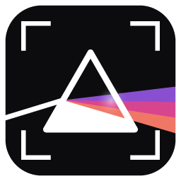
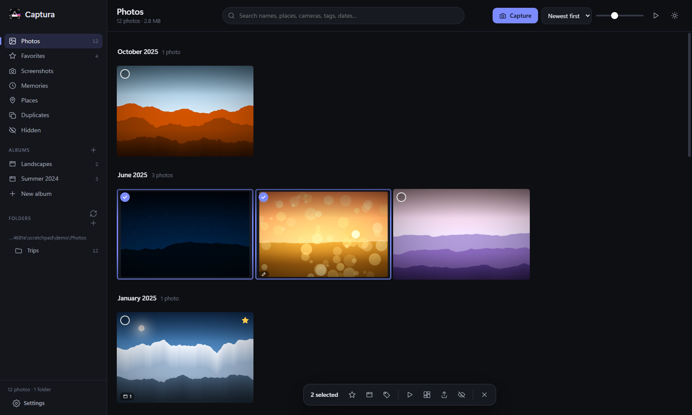
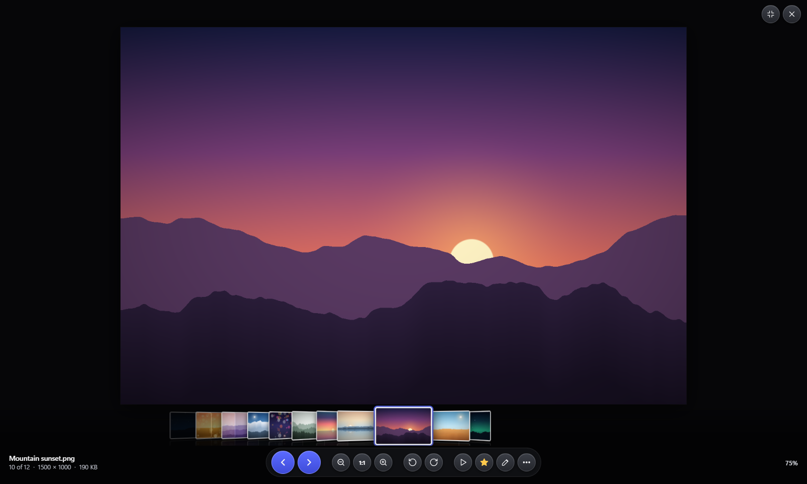
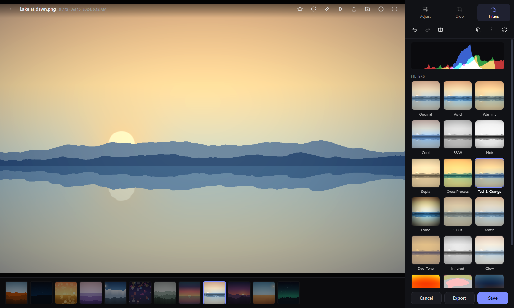
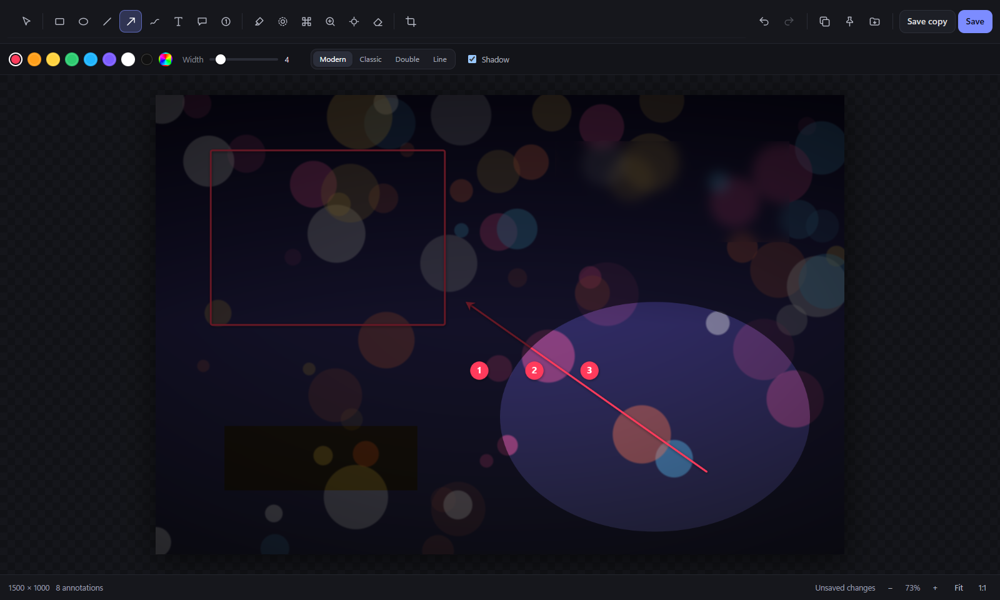
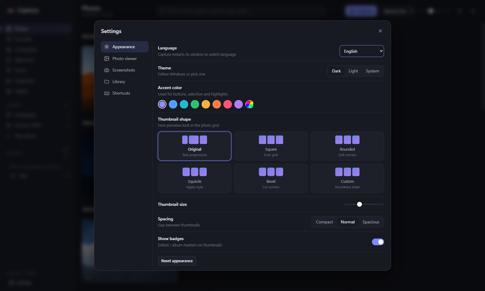
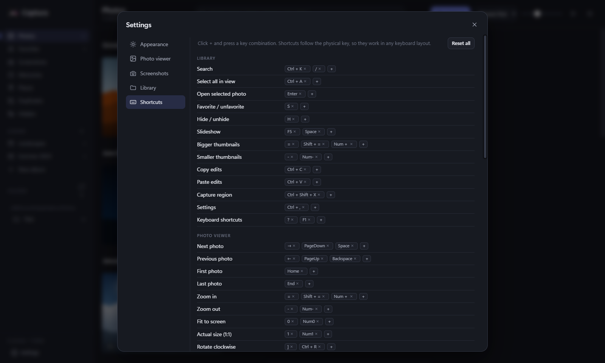
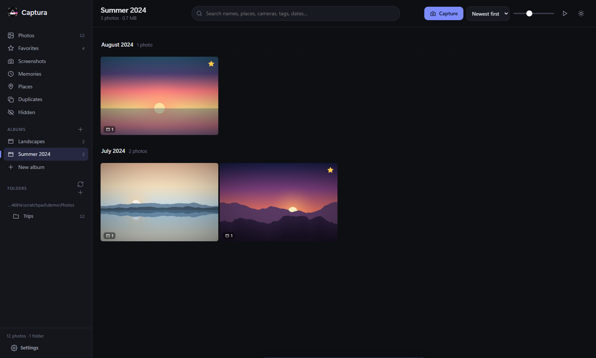
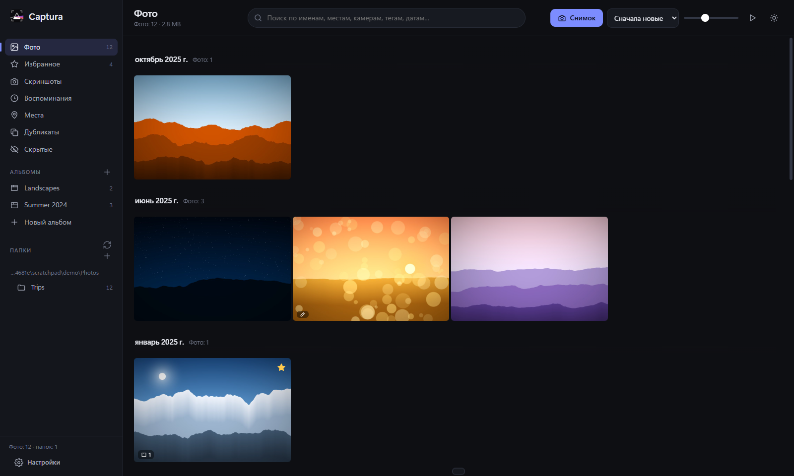

<div align="center">



# Captura

**Your photo library, a fast Picasa-style viewer and a ShareX-style screenshot tool — in one Windows app.**

Native Rust app · 2 MB installer · everything runs locally · your original photos are never modified.

<a href="../../releases/latest"></a>


<br><br>



</div>

---

## ✨ Highlights

<table>
<tr>
<td width="50%" valign="top">

### 🖼️ Library
Watched folders, a month-by-month timeline, favorites, albums, tags and captions.
Find anything by name, place, camera, tag or date. Memories, a Places map and a
duplicate finder that also catches resized copies.

</td>
<td width="50%" valign="top">

### 👁️ Photo viewer
Opens full screen in a blink — cached preview first, full image right after.
Wheel zoom, 1:1, rotate, a 3D filmstrip and slideshows. Click the backdrop for
window mode. Set it as your **Open with** app in Explorer.

</td>
</tr>
<tr>
<td valign="top">

### 🎨 Non-destructive editor
Auto enhance, light / color / detail sliders, crop & straighten, 17 filters,
before/after compare, copy & paste edits across photos, export to JPEG, WebP or PNG.

</td>
<td valign="top">

### 📸 Screen capture
Region with window snapping and a pixel magnifier, active window, full screen,
last region and delayed capture — from global hotkeys, the tray or the app.

</td>
</tr>
<tr>
<td valign="top">

### ✏️ Screenshot editor
Rectangle, ellipse, arrow, freehand, text, speech balloon, step numbers, highlight,
blur, pixelate, magnify, spotlight, smart eraser and crop. Copy, save or **pin to screen**.

</td>
<td valign="top">

### ⚙️ Make it yours
Dark / light / system theme, accent colors, thumbnail shapes (incl. Apple-style
squircle), spacing, viewer behavior and fully remappable keyboard shortcuts.

</td>
</tr>
</table>

## 📷 Screenshots

<div align="center">

**Picasa-style photo viewer**



<br><br>

**Non-destructive editor with live filter previews**



<br><br>

**Screenshot editor — annotate, redact, highlight**



</div>

<table>
<tr>
<td width="50%"><p align="center"><sub>Themes, accents and thumbnail shapes</sub></p></td>
<td width="50%"><p align="center"><sub>Every shortcut can be remapped</sub></p></td>
</tr>
<tr>
<td width="50%"><p align="center"><sub>Albums</sub></p></td>
<td width="50%"><p align="center"><sub>Five languages — here in Russian</sub></p></td>
</tr>
</table>

## ⌨️ Default shortcuts

| Where | Keys |
| --- | --- |
| Anywhere (global) | <kbd>Ctrl</kbd>+<kbd>PrtSc</kbd> region · <kbd>PrtSc</kbd> full screen · <kbd>Alt</kbd>+<kbd>PrtSc</kbd> active window · <kbd>Ctrl</kbd>+<kbd>Shift</kbd>+<kbd>PrtSc</kbd> last region |
| Library | <kbd>Ctrl</kbd>+<kbd>K</kbd> search · <kbd>S</kbd> favorite · <kbd>H</kbd> hide · <kbd>Enter</kbd> open · <kbd>F5</kbd> slideshow · <kbd>?</kbd> shortcuts |
| Viewer | <kbd>←</kbd> <kbd>→</kbd> browse · wheel zoom (<kbd>Ctrl</kbd>+wheel browses) · <kbd>0</kbd> fit · <kbd>1</kbd> 1:1 · <kbd>[</kbd> <kbd>]</kbd> rotate · <kbd>E</kbd> edit · <kbd>F11</kbd> window |
| Screenshot editor | <kbd>V</kbd> <kbd>R</kbd> <kbd>E</kbd> <kbd>A</kbd> <kbd>T</kbd> <kbd>S</kbd> <kbd>U</kbd> <kbd>X</kbd> <kbd>C</kbd> tools · <kbd>Ctrl</kbd>+<kbd>C</kbd> copy · <kbd>Ctrl</kbd>+<kbd>S</kbd> save |

All in-app shortcuts can be changed in **Settings → Shortcuts**; they follow the physical key, so they keep
working with any keyboard layout.

## 📥 Install

1. Download **Captura_2.0.0_x64-setup.exe** from [Releases](../../releases/latest).
2. Run it — it installs for your user, no admin rights needed.
3. Optional: right-click a photo → **Open with** → **Captura** → *Always* to make it your viewer.

The installer adds a Start menu shortcut and registers Captura in Explorer's **Open with** list
without taking over your current default app. Closing the window keeps Captura in the tray so the
capture hotkeys keep working (turn this off in Settings). Uninstall from *Settings → Apps*; your library
is kept in `%APPDATA%\Captura`.

## 🧩 How it's built

```
┌──────────────────────────── Captura.exe (Rust) ────────────────────────────┐
│  Tauri 2 shell     windows · tray · global hotkeys · single instance        │
│  capture.rs        xcap screen/window grabs · crops · window snapping       │
│  server.rs         library index · EXIF · scans · exports (127.0.0.1 only)  │
│  meta.rs           image size + EXIF reader                                 │
└───────────────────────────────────┬─────────────────────────────────────────┘
                                    │  system WebView2 renders the UI
                        public/  ── library · viewer · editors · overlay
```

The UI is drawn by Windows' own WebView2, so there is no bundled browser — the app is a single
6 MB executable.

## 🛠️ Build from source

Requires [Rust](https://rustup.rs) (MSVC toolchain) and Node.js 22.23.4+ or 24.22.1+.

```bash
npm install
npm run dev        # run the app
npm run build      # installer: src-tauri/target/release/bundle/nsis/Captura_<version>_x64-setup.exe
```

> On Windows the MSVC linker fails on very long paths (`LNK1104`). If that happens, set a short
> target folder first, for example `set CARGO_TARGET_DIR=C:\ctb`.

`node scripts/demo-photos.mjs <folder>` renders the demo landscapes used in these screenshots.

<details>
<summary><b>Project layout</b></summary>

| Path | What |
| --- | --- |
| `src-tauri/src/main.rs` | windows, tray, hotkeys, capture flow, pins, IPC commands |
| `src-tauri/src/server.rs` | local server — library index, scans, thumbnails, exports |
| `src-tauri/src/capture.rs` | screen and window capture |
| `src-tauri/src/meta.rs` | image size and EXIF |
| `src-tauri/src/i18n.rs` | tray and notification strings |
| `public/` | UI — library, viewer, editors, region overlay |
| `public/locales/` | translations (es, fr, ru, zh) |
| `scripts/` | icon renderer, vendor copy, demo photos |
| `build/tauri-hooks.nsh` | installer additions (Open with registration) |

</details>

---

<div align="center"><sub>Viewer inspired by Picasa 3 · capture workflow inspired by ShareX · all code original</sub></div>
